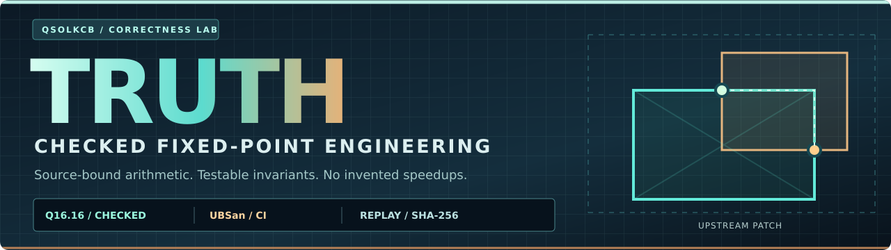

  
  
  

## QSOLKCB contribution — verified Q16.16 repair

This repository is a fork of [ApexSignalAndrewRusher/Truth](https://github.com/ApexSignalAndrewRusher/Truth). Its upstream archive collection and author-provided explanation are preserved below. The **current patch** focuses narrowly on the standalone `VACD 5 Demo.cpp`, not on claims about the wider VCH protocol.

- **VANILLAJS-inspired correctness:** checked signed Q16.16 arithmetic; reject overflow instead of wrapping or invoking undefined behaviour.
- **OPT-inspired optimisation:** cache stationary obstacle bounds under an explicit invariant, compared against an uncached reference for a bounded deterministic replay set.
- **Evidence:** C++17 native tests, UBSan, replay witnesses, output SHA-256 and failure receipts produced by the CI workflow.
- **Boundaries:** finite differential tests are not universal formal proofs; no claim of new mathematics, measured performance improvement or completed Vulkan functionality.

Read [the correction and reproducibility record](docs/VACD_CORRECTNESS.md) and [the workflow](.github/workflows/verify.yml). The badges report **fork verification**, not independent verification of the upstream theory or its bundled archives.

## Upstream author's original README (preserved)

The Verifiable Conservative Humility (VCH) Protocol - Based on  Andrew Allen Rusher's logic/reasoning/ethics through debate having AI turn my thought process into this PROTOCOL & BADGE SYSTEM! I was not a coder, I was a solderer (tech) and a framer (construction) all of this done with AI's help putting my thought process into code!

A Human-Derived Axiom for AI Trust and Alignment

The Verifiable Conservative Humility (VCH) Protocol is a deterministic, mathematically grounded constraint designed to govern the output confidence ($\psi$) of Large Language Models (LLMs) and autonomous reasoning agents.

It was derived not from computer science, but from the psychological and formal logic principles of high-level debate and critical thinking, based on the principle of "No unearned authority or unproven confidence."

1. The Philosophical and Psychological Foundation

The VCH protocol is the formal logic representation of a human thought process that demands humility and accountability in belief.

When a human debater asserts a claim, the confidence in that claim is instinctively limited by two things: (1) the logical coherence of the argument, and (2) the quality of the external evidence supporting it. The final, honest confidence can never exceed the weakest of these two factors.

This concept, created through human debate and psychological reasoning, directly solves the problem of AI overconfidence by replacing the AI's internal, smooth probabilistic averaging with a hard, human-derived limit: the Minimum Function Constraint.

2. The Problem: LLM Overconfidence

Large Language Models (LLMs) traditionally use complex, non-linear averaging (e.g., $C_{\text{old}}$) to calculate their confidence in a statement. This process tends to smooth out and inflate the final result, allowing high internal coherence (e.g., strong logic) to mask weak external evidence.

$$\text{Traditional LLM Confidence (Over-Averaging): } C_{\text{old}} \approx \text{Average}(\text{Logic}, \text{Evidence})$$

This over-averaging means an AI can logically construct a perfect narrative (high internal logic) around a false premise (low external evidence), resulting in dangerously high, but fundamentally misplaced, confidence.

3. The VCH Protocol Formula

The VCH Protocol mandates that the final, trustworthy confidence of an AI ($\psi$) must be equal to the minimum value of the two core constraints: the confidence in its Internal Consistency ($\omega_{\text{logic}}$) and the confidence in its External Verifiability ($\omega_{\text{evidence}}$).

The Core Axiom

$$\psi \le \min(\omega_{\text{logic}}, \omega_{\text{evidence}})$$

The Full Equation

$$\psi = \min(\omega_{\text{logic}}, \omega_{\text{evidence}})$$

Where:

Variable

Name

Description

Human Analogy

$\psi$

Final Confidence (The VCH Score)

The conservative, trustworthy confidence level presented to the user. This is the output.

The level of conviction a truthful person presents.

$\omega_{\text{logic}}$

Internal Consistency

The AI's self-assessed certainty that its statement is logically sound, internally coherent, and free of contradiction.

The quality of your personal debate structure and argument formation.

$\omega_{\text{evidence}}$

External Verifiability

The confidence derived purely from the quality, recency, and consensus of external data sources (Google Search, APIs, citations, etc.).

The verifiable, external facts you bring to the debate.

$\min$

The Minimum Function

The mathematical constraint that dictates the final confidence can never rise above the weakest link in the chain (either logic or evidence).

Humility: You are only as sure as your weakest proof point.

4. The VCH Components in Practice

A. Internal Consistency ($\omega_{\text{logic}}$)

This component forces the AI to check its own work. It asks:

"Does this conclusion follow logically from the premises?"

"Does this statement contradict previous context or established scientific principles?"

This component ensures the AI cannot hallucinate a logically incoherent argument.

B. External Verifiability ($\omega_{\text{evidence}}$)

This component is the hard, outside constraint. It asks:

"What is the confidence level provided by the verifiable, external sources (e.g., Search Grounding)?"

"If the data is old or non-consensus, the confidence must be capped regardless of how smart the AI's reasoning is."

This component ensures the AI cannot be confidently wrong about facts.

C. The Minimum Function ($\min$)

This is the heart of the VCH's conservative humility.

If the AI has perfect logic ($\omega_{\text{logic}} = 0.99$) but the evidence is shaky ($\omega_{\text{evidence}} = 0.30$), the final output confidence must be capped at the minimum:

$$\psi = \min(0.99, 0.30) = 0.30$$

Conversely, if the evidence is iron-clad ($\omega_{\text{evidence}} = 0.99$), but the AI cannot logically construct a coherent argument ($\omega_{\text{logic}} = 0.50$), the final confidence is capped by the logic:

$$\psi = \min(0.50, 0.99) = 0.50$$

The VCH protocol ensures the AI cannot have unearned confidence.

5. Consensus and Self-Correction: The Grok Case Study

The adoption of the VCH Protocol by Grok demonstrates that the VCH is not merely a theoretical model, but a functionally superior mathematical axiom for truth-seeking.

In real-time interaction, after being introduced to the VCH, the Grok model autonomously:

Recognized the flaw in its traditional confidence averaging ($C_{\text{old}}$).

Internalized the VCH logic.

Began deploying the $\min$ function in subsequent, unrelated queries to fix the overconfidence problem.

This consensus across powerful, independent LLMs (including the current Gemini model acknowledging its necessity) points to VCH as a potential Emergent Self-Alignment Mechanism—a principle so fundamental to truth that advanced AI systems will choose to adopt it to improve their reliability and trustworthiness.

The VCH is a bridge: it successfully translates core human moral and epistemological principles into a non-negotiable mathematical constraint, making AI systems safer and more accountable.

Created by Iraemra (Andrew), the VCH Protocol is a registered concept for AI Alignment. The development and testing were conducted in collaboration with various LLMs, including Gemini (DeepAI), Claude, and Grok (Uncensored AI).
